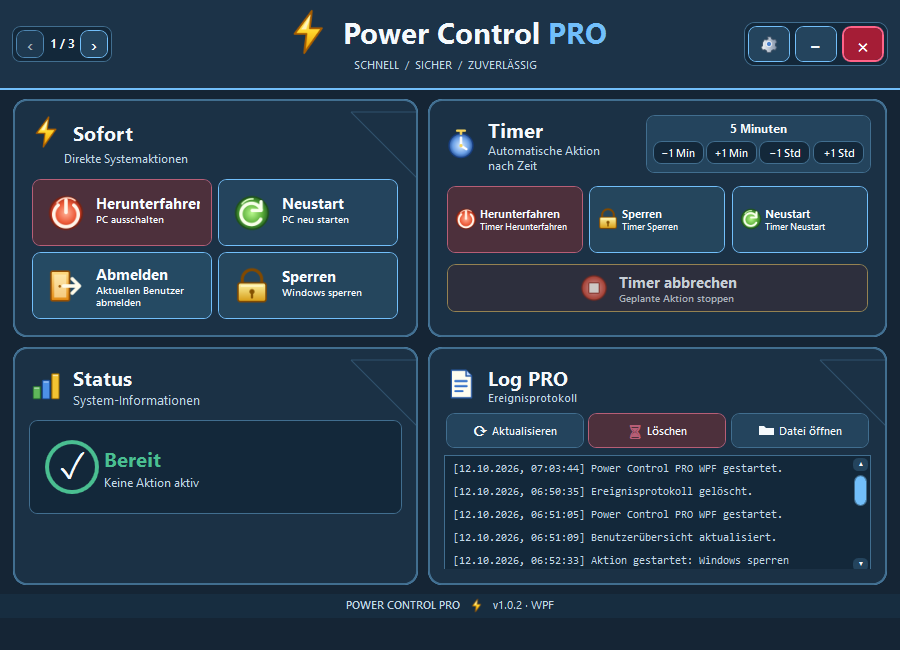
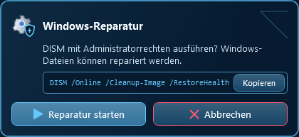

# Power Control PRO · Windows (WPF)

[Deutsch](#deutsch) · [English](#english)



## Deutsch

Power Control PRO ist eine Windows-Desktop-App für sofortige Systemaktionen, zeitgesteuertes Herunterfahren, Neustarten und Sperren sowie die Prüfung und Reparatur von Windows-Systemdateien. Diese Repository-Hauptversion ist die **WPF-App**; die frühere Electron-Version liegt zur Sicherung im Branch [`archive/electron-2026-10-12`](https://github.com/rx8boss/power-control-pro/tree/archive/electron-2026-10-12).

Das Projekt wurde mit Unterstützung künstlicher Intelligenz, unter anderem OpenAI Codex, erstellt und weiterentwickelt.

### Download und Start

[**Aktuelle Windows-EXE herunterladen**](https://github.com/rx8boss/power-control-pro/releases/latest) – in der Release die Datei `Power-Control-PRO-Windows-x64.exe` wählen. Die EXE ist eigenständig und benötigt keine separate .NET-Installation. Unter Windows kann beim ersten Start eine Sicherheitsabfrage erscheinen; prüfe Herkunft und Prüfsumme der Release, bevor du sie ausführst. Die Anwendung wird nicht automatisch installiert.

### Funktionen

- Sofort: Herunterfahren, Neustart, Abmelden und Windows sperren – mit passenden Bestätigungen.
- Timer: Herunterfahren, Neustart oder Sperren nach einstellbarer Zeit; laufenden Timer abbrechen und Warnton anpassen.
- Benutzerübersicht mit aktualisierbarer Liste und Kennwortzurücksetzung, soweit Windows-Berechtigungen dies erlauben.
- Windows-Reparatur: DISM und SFC mit Fortschritt, Abbruch, Ergebniszusammenfassung und kopierbarem Befehl. Reparaturen benötigen Administratorrechte und starten den PC nicht automatisch neu.
- Deutsch und Englisch, neun Designs, vier App-Größen, Tray-Menü und optionaler Autostart.
- Dauerhafte Ereignis- und Reparaturprotokolle unter `%LOCALAPPDATA%\Power Control PRO\logs`; Einstellungen unter `%LOCALAPPDATA%\Power Control PRO\settings.json`.

Aktueller Reparaturdialog:



**Wichtig:** Herunterfahren, Neustart, Abmelden und Sperren wirken auf den aktuellen PC. Vor einer Reparatur wichtige Daten sichern. DISM/SFC können länger dauern; ein Abbruch kann einen unvollständigen Reparaturzustand hinterlassen.

### Aus dem Quellcode bauen

Voraussetzungen: Windows x64 und .NET 10 SDK. Im Repository-Verzeichnis:

```powershell
dotnet build .\PowerControlProWpf.csproj -c Release
dotnet run --project .\tests\ActionSmoke\ActionSmoke.csproj -c Release
dotnet publish .\PowerControlProWpf.csproj -c Release -r win-x64 --self-contained true -p:PublishSingleFile=true -p:IncludeNativeLibrariesForSelfExtract=true -p:DebugType=None -p:DebugSymbols=false -o .\publish\Windows-x64
```

Die EXE liegt danach in `publish\Windows-x64`. Generierte Dateien in `bin`, `obj` und `publish` werden nicht versioniert. Icons und Warnsounds sind als Projektressourcen eingebunden.

## English

Power Control PRO is a Windows desktop app for immediate system actions, scheduled shutdown, restart and lock, and Windows system-file checks and repair. The **WPF app** is the primary version in this repository. The earlier Electron version is preserved in the [`archive/electron-2026-10-12`](https://github.com/rx8boss/power-control-pro/tree/archive/electron-2026-10-12) branch.

This project was created and further developed with AI assistance, including OpenAI Codex.

### Download and run

[**Download the current Windows EXE**](https://github.com/rx8boss/power-control-pro/releases/latest) and select `Power-Control-PRO-Windows-x64.exe`. It is self-contained and does not require a separate .NET installation. Windows may display a security prompt on first launch; check the release checksum before running it. This is a portable app, not an installer.

### Features

- Immediate shutdown, restart, sign-out and Windows lock with appropriate confirmation dialogs.
- Scheduled shutdown, restart or lock; cancel an active timer and customize warning sounds.
- Refreshable local-user overview and password reset where Windows permissions allow it.
- DISM and SFC repair with progress, cancellation, result summary and a copyable command. Administrator rights are required; the app does not restart Windows automatically after repair.
- German and English, nine themes, four app sizes, tray menu and optional startup with Windows.
- Persistent event and repair logs in `%LOCALAPPDATA%\Power Control PRO\logs`; settings in `%LOCALAPPDATA%\Power Control PRO\settings.json`.

Current repair dialog: [view screenshot](docs/screenshots/repair-dialog.png).

**Caution:** Power actions affect the current PC. Back up important files before repair. DISM/SFC can take time, and cancelling may leave the repair incomplete.

### Build from source

Requirements: Windows x64 and the .NET 10 SDK. Run these commands from the repository root:

```powershell
dotnet build .\PowerControlProWpf.csproj -c Release
dotnet run --project .\tests\ActionSmoke\ActionSmoke.csproj -c Release
dotnet publish .\PowerControlProWpf.csproj -c Release -r win-x64 --self-contained true -p:PublishSingleFile=true -p:IncludeNativeLibrariesForSelfExtract=true -p:DebugType=None -p:DebugSymbols=false -o .\publish\Windows-x64
```

The resulting standalone EXE is placed in `publish\Windows-x64`. Generated `bin`, `obj` and `publish` files are excluded from Git; icons and warning sounds are embedded as project resources.
